<h1 align="center">DataFusion AI</h1>

<p align="center"><strong>Multi-Source Data Fusion &amp; Machine Learning Platform</strong></p>

<p align="center">
Upload related datasets, clean and reconcile them into one table, explore the result, compare four machine-learning models, score new records and export a shareable report — all in a single workspace where every number is computed from the files you provide.
</p>

<p align="center">
  
  
  
  
  
  
  
  
</p>

<p align="center">
  
  
  
  
</p>

<p align="center">
  <a href="https://datafusion-ai-frontend.vercel.app/"><strong>Live Application</strong></a> ·
  <a href="https://datafusion-ai-production.up.railway.app/api/health">API Health</a> ·
  <a href="https://datafusion-ai-production.up.railway.app/docs">API Documentation</a> ·
  <a href="https://github.com/Adithyaravi10/DataFusion-AI">Repository</a>
</p>

---

## Table of Contents

- [Overview](#overview)
- [Problem Statement and Proposed Solution](#problem-statement-and-proposed-solution)
- [Live Application](#live-application)
- [Screenshots](#screenshots)
- [Core Features](#core-features)
- [Application Workflow](#application-workflow)
- [System Architecture](#system-architecture)
- [Technology Stack](#technology-stack)
- [Machine Learning](#machine-learning)
- [AI Provider Fallback](#ai-provider-fallback)
- [Project Structure](#project-structure)
- [Local Setup](#local-setup)
- [Environment Variables](#environment-variables)
- [API Overview](#api-overview)
- [Production Deployment](#production-deployment)
- [Known Limitations](#known-limitations)
- [Future Enhancements](#future-enhancements)
- [Contributing](#contributing)
- [License](#license)

---

## Overview

DataFusion AI is a full-stack data engineering and analytics workspace. A user uploads two or more related datasets that share a key — customers and orders, students and marks, products and sales — and the platform turns them into one reconciled table that can be analysed, modelled and reported on.

The product covers the complete data lifecycle in one place:

| Stage | What happens |
| --- | --- |
| Collect | Files are validated (format, size, emptiness), parsed with encoding and delimiter fallbacks, profiled and previewed. |
| Wrangle | Each source is cleaned independently: formats normalised, safe gaps filled, identifiers protected, outliers capped, duplicates removed — with a per-column audit trail. |
| Fuse | Shared keys are detected from column names and value overlap, near-identical keys are linked with fuzzy matching, and conflicting values are resolved under an explicit, logged rule. |
| Analyse | Statistical summaries, missingness, correlations and rule-based insights are computed on the fused table. |
| Model | Four estimators are trained on an identical split, cross-validated, compared and the best one is persisted. |
| Predict | One record can be scored through a schema-aware form; a CSV can be scored in batch. |
| Report | A multi-page PDF, the fused CSV and a multi-sheet Excel workbook are generated from the stored run. |

Two properties shape the design:

- **Everything is computed from the uploaded data.** There is no seeded demo dataset, no fallback table and no hard-coded KPI. Random state is fixed at `42`, so the same inputs produce the same metrics.
- **AI is optional and additive.** AI Insights interprets statistics that have already been computed and never produces numbers itself. Without any provider key the rest of the application behaves identically.

The interface is a React single-page application with a light and dark theme, a live 3D "fusion core" rendered with Three.js, and a workspace sidebar that unlocks sections only after fusion succeeds.

---

## Problem Statement and Proposed Solution

### The problem

Data used in real analysis rarely arrives as a single tidy file. It arrives as an export of customers, a separate export of transactions, and a spreadsheet maintained by hand. Before any modelling can begin, an analyst has to:

1. detect which columns actually join the tables,
2. survive inconsistent formats — `$1,299.00`, `2024-03-01`, `03/01/2024`, `India` vs `india `,
3. decide what a conflicting value means when two sources disagree,
4. document every transformation so the result is defensible,
5. and repeat all of it in ad-hoc notebooks that are never reusable.

Each step is individually simple and collectively expensive, and the documentation step is the first one skipped.

### The proposed solution

DataFusion AI makes that pipeline explicit, inspectable and repeatable:

- **Automated but explainable fusion.** Join keys are proposed from name similarity and value overlap; near-matches are linked with RapidFuzz and flagged; ambiguous plans pause the job and ask the user instead of guessing.
- **Traceable wrangling.** Every cleaning action is recorded with before/after counts and the method used, and that log is carried into the Excel workbook and the PDF report.
- **Honest evaluation.** All four models train on the same split; the winner is selected on cross-validated performance and the held-out score is reported afterwards, so the reported number is not the one used for selection.
- **A single artefact set.** PDF narrative, fused CSV and Excel summary are generated from the same stored run, so numbers cannot drift between deliverables.
- **Nothing hidden behind a paid dependency.** The platform runs entirely on local computation; AI interpretation is an optional enhancement with a provider fallback chain.

---

## Live Application

| Environment | URL |
| --- | --- |
| Frontend (Vercel) | <https://datafusion-ai-frontend.vercel.app/> |
| Backend API (Railway) | <https://datafusion-ai-production.up.railway.app> |
| Health check | <https://datafusion-ai-production.up.railway.app/api/health> |
| Interactive API docs | <https://datafusion-ai-production.up.railway.app/docs> |

The deployed pair is split by design: the SPA is a static Vercel build, and the FastAPI service runs on Railway with a persistent volume. CORS on the backend is restricted to the deployed frontend origin through `CORS_ORIGINS`.

> Sessions are private to the browser that created them (see [Production Deployment](#production-deployment)). The live instance is a portfolio/demo deployment — do not upload confidential data.

---

## Screenshots

All captures below come from the running application. The theme and mobile captures are stored at the repository root; the numbered captures in [`docs/screenshots/`](docs/screenshots/) follow the application flow, beginning with a full-width landing capture.

### Landing Page

<table>
  <tr>
    <td width="50%" valign="top">
      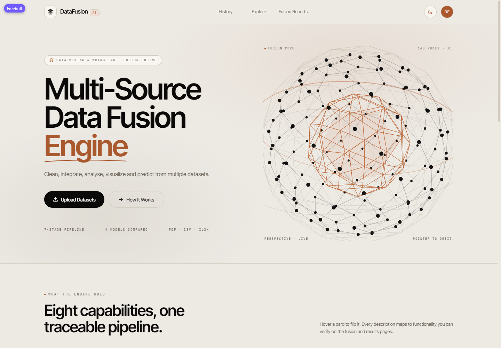
      <sub><b>Light theme, desktop</b> — hero headline over the live 3D fusion core, with the pipeline and export summary strip.</sub>
    </td>
    <td width="50%" valign="top">
      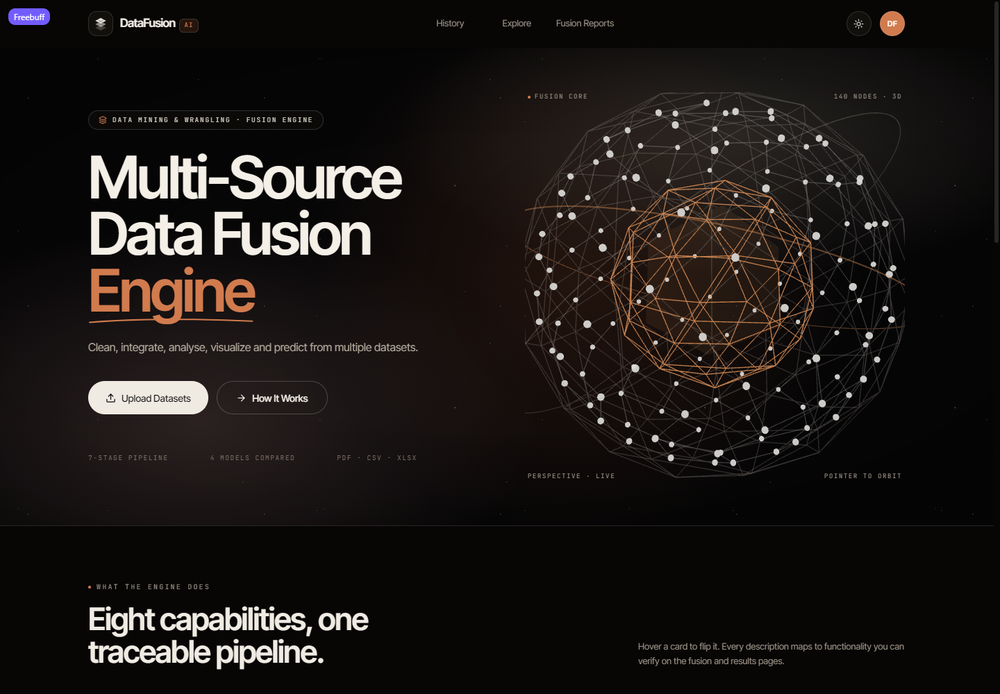
      <sub><b>Dark theme, desktop</b> — the same hero and fusion core rendered with the dark palette.</sub>
    </td>
  </tr>
  <tr>
    <td colspan="2">
      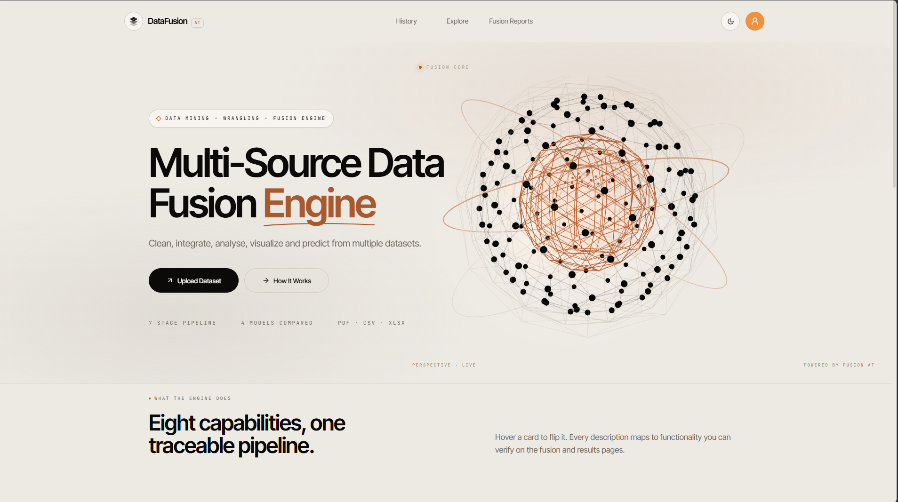
      <sub><b>01 · Full desktop width, light theme</b> — the hero, its “7-stage pipeline · 4 models compared · PDF · CSV · XLSX” strip, and the opening of the “Eight capabilities, one traceable pipeline” section.</sub>
    </td>
  </tr>
</table>

<p align="center">
  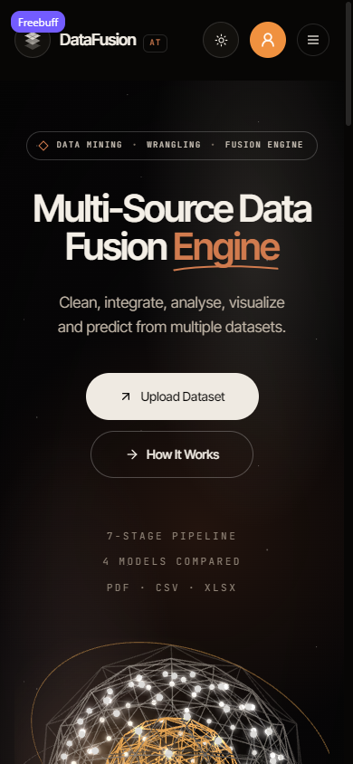
  <br>
  <sub><b>Mobile, 390 px width</b> — the workspace sidebar collapses into a drawer.</sub>
</p>

### Application Workflow

<table>
  <tr>
    <td width="50%" valign="top">
      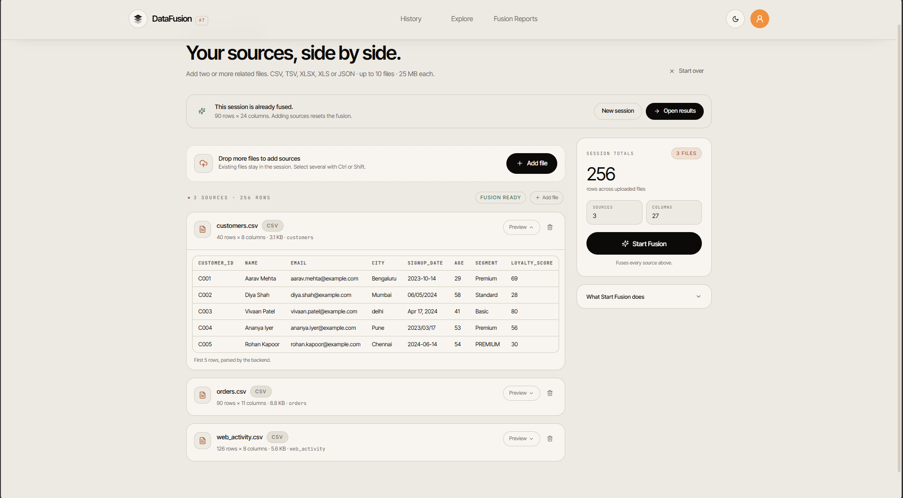
      <sub><b>02 · Upload</b> — three CSV sources (customers, orders, web_activity) totalling 256 rows across 3 sources and 27 columns, an expanded five-row preview of <code>customers.csv</code>, and a session that is already fused to 90 rows × 24 columns, with <b>Start Fusion</b> still available.</sub>
    </td>
    <td width="50%" valign="top">
      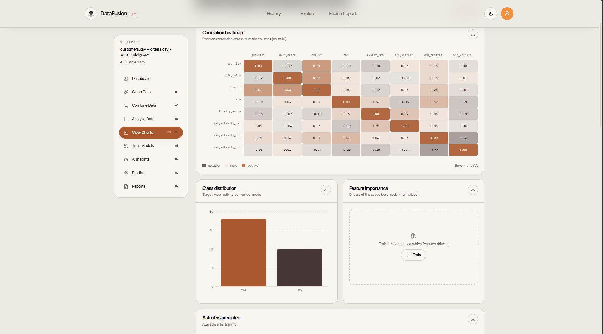
      <sub><b>03 · View Charts</b> — Pearson correlation heatmap across the fused numeric columns, the Yes/No class distribution of the selected target, and a feature-importance card that asks for training before it fills in.</sub>
    </td>
  </tr>
  <tr>
    <td width="50%" valign="top">
      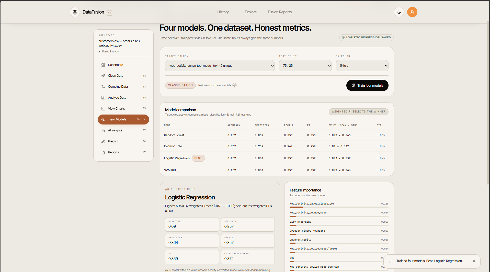
      <sub><b>04 · Train Models</b> — Random Forest, Decision Tree, Logistic Regression and SVM compared on one split with accuracy, precision, recall, F1, cross-validated F1 and fit time; Logistic Regression is marked best, with its held-out metrics and top feature importances below.</sub>
    </td>
    <td width="50%" valign="top">
      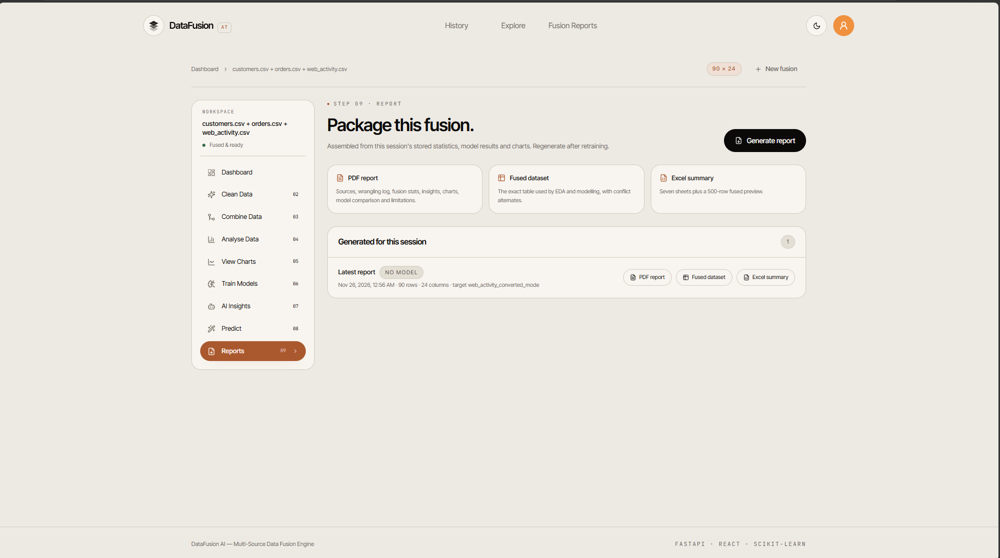
      <sub><b>05 · Reports</b> — the three artefacts built from the stored run (PDF report, fused dataset, Excel summary) and the latest report entry with a download button per format.</sub>
    </td>
  </tr>
</table>

---

## Core Features

### Multi-source data upload

- Accepts **CSV, TSV, XLSX, XLS and JSON**, up to **10 sources per session**, **25 MB** and **200,000 rows per file**.
- Drag-and-drop or multi-select from the file picker; each file is validated and parsed server-side with encoding (`utf-8-sig`, `utf-8`, `latin-1`) and delimiter fallbacks.
- Rejections are specific and non-destructive — an unsupported extension, an empty file, malformed JSON, a zero-column frame or an oversized dataset returns HTTP 400 with the reason and uploads nothing.
- Every accepted file exposes its real dimensions, a five-row preview and per-column profiles (dtype, missing count, cardinality, samples).
- Files can be added to an existing session; duplicates are detected by SHA-256 and refused, and adding a source after fusion invalidates the previous fused output and model with an explicit warning. Individual sources can also be removed.

### Data cleaning and preprocessing

- Whitespace trimming and collapsing in text columns.
- Numeric parsing for values such as `$1,299.00`, ` 34 `, `12%`, guarded by column-name hints and parse-ratio thresholds so free text is not coerced by mistake.
- Mixed date parsing (`format="mixed"`) with a validity ratio, so `2024-01-05` and `05/01/2024` in the same column are reconciled.
- Consistent casing for low-cardinality categorical columns.
- Missing values filled by **median** (numeric), **mode** (categorical), **forward/backward fill** (datetime) or a constant, with the choice recorded per column.
- **Identifiers are never imputed**, and the model target is explicitly protected so labels are never invented.
- IQR outlier capping on numeric columns with enough spread, reported per column with bounds and example values.
- Duplicates are detected **before** imputation, so rows that differ only by a blank cell are not collapsed.
- The report is downloadable: each cleaned source is available as CSV.

### Intelligent data fusion

- Candidate join keys are scored from **name similarity plus value overlap** using canonical key tokens, so `1`, `1.0` and `" 1 "` compare equal.
- The richest table (most columns, then most rows) becomes the **base table**; other sources join onto it one at a time along the strongest available candidate.
- **RapidFuzz token-sort matching at a threshold of 88** links values that differ by punctuation, spacing or word order; fuzzy links are counted and logged separately from exact matches.
- Many-to-one relationships are aggregated rather than duplicated (sum for count-like columns).
- Conflicts are resolved by an explicit precedence — **non-null → most recent source → majority value** — and every resolved conflict is recorded with its alternatives.
- When no key can be found, or coverage is too low to be safe, the job **pauses as `awaiting_confirmation`** and the UI asks the user to choose the keys; the pipeline resumes with those overrides.

### Exploratory data analysis

- Dataset-level statistics: record count, feature count, remaining missing percentage, duplicate rows, numeric and categorical column counts.
- Per-column overview and a five-number statistical summary (min, Q1, median, Q3, max, mean) for up to twelve numeric columns.
- Pearson correlation matrix over numeric, non-identifier columns.
- **Rule-based, deterministic insights** — duplicate rows, the three most-missing columns, strong correlations (|r| ≥ 0.7), skewed distributions (|skew| > 1.5), target imbalance, high-cardinality text columns and small-dataset warnings.
- Optional target suggestion with an inferred task type and a written reason; the user can override both.

### Interactive visualizations

- Correlation heatmap, target distribution (class counts or histogram), up to six numeric histograms with IQR-annotated box plots, feature importance, actual-vs-predicted pairs and a confusion matrix for classification.
- All charts are rendered from API data with Recharts, so tooltips and legends stay interactive.
- Any chart card can be exported as a PNG through `html2canvas`, using a filename derived from the chart.

### Machine learning model training

- Four estimators compared on an identical split: **Random Forest, Decision Tree, Logistic Regression, SVM (RBF)** — classification and regression variants are chosen automatically from the target.
- Configurable test size (0.15, 0.20, 0.25, 0.30 or 0.40, default 0.25) and CV folds (3, 5 or 10, default 5), with stratified folds for classification and a fixed seed of `42`.
- Numeric features are median-imputed and standard-scaled; categorical features are mode-imputed and one-hot encoded, all inside a scikit-learn `Pipeline`.
- The winner is selected on **cross-validated** weighted F1 (classification) or R² (regression); the held-out score is reported after selection, together with a plain-language reason.
- Feature importance comes from native importances/coefficients or permutation importance when the estimator has no intrinsic measure.
- The trained pipeline is persisted with `joblib` and reused for predictions.

### Individual and batch predictions

- **Single record:** a schema-aware form pre-fills numeric medians and categorical modes, and rejects unknown feature names, missing fields and non-numeric values with specific messages.
- **Batch:** upload a CSV or TSV with the required feature columns (up to 5,000 rows) and receive predictions with class probabilities and a confidence column where the estimator supports them.
- Batch results preserve the original columns and are downloadable as CSV.

### AI-powered insights

- An optional interpretation layer over statistics the backend has already computed: dataset size, missingness, top correlations, rule-based insights and model metrics.
- **Aggregate values only** — the prompt is built from statistics, never from raw rows, and is bounded in size without truncating JSON mid-object.
- Providers are attempted in a configured order with retries on transient failures; each attempt is recorded with provider, model, token counts and fallback state.
- The generated interpretation is cached per session and clearly labelled as interpretation, not computation.
- If no provider is configured, only this tab is unavailable; fusion, EDA, modelling and reporting are unaffected.

### PDF, CSV and Excel reports

- **PDF** (ReportLab): title page content, source inventory, wrangling summary, fusion plan, exploratory findings, embedded matplotlib charts, model comparison table, selected model with its reasoning, and a limitations section.
- **Fused CSV**: the complete reconciled dataset.
- **Excel** (OpenPyXL): seven worksheets — Summary, Cleaning, Fusion, Models, Feature Importance, Insights and a 500-row Fused Preview.
- Reports are listed on a dedicated Fusion Reports page and downloadable per format with correct MIME types and filenames.

### Session history and persistence

- Sessions live on disk under `DATA_DIR` (default `backend/data/`), one folder per session containing raw uploads, processed files, the fused dataset, the model, predictions and reports.
- History lists every session owned by the current browser across five columns — Session, Status, Rows × features (with the target when one is set), Created and Model; sessions can be reopened or deleted (deleting removes the folder and its job files).
- Because the state is on disk rather than in memory, history and reports survive page refreshes and server restarts — provided the deployment has a persistent volume.

---

## Application Workflow

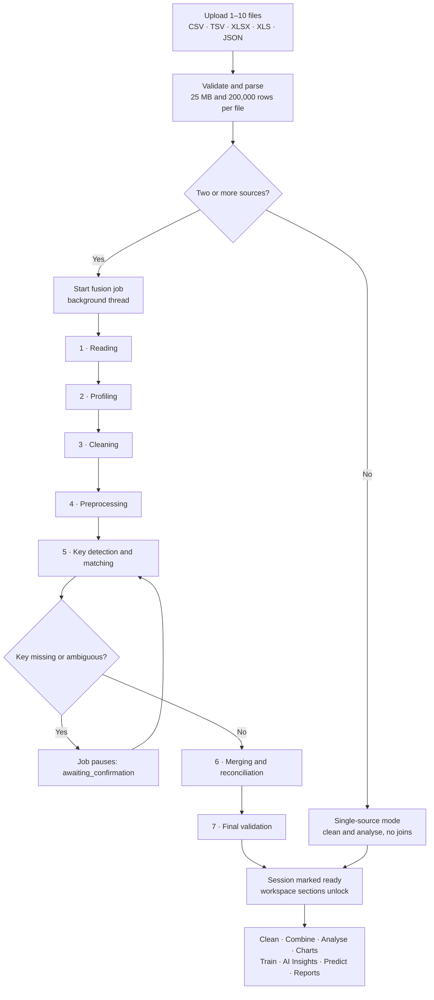

The seven stages are executed by the backend, not simulated in the browser. The fusion screen polls the job status endpoint every 900 ms (an SSE endpoint is also available) and renders the server's real stage list, durations and log lines. Progress is derived from completed stages, and each log entry is timestamped in the configured display timezone.

---

## System Architecture

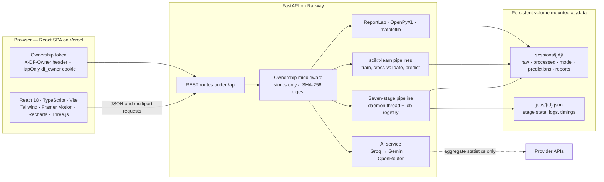

Key architectural decisions:

- **Split deployment.** Static frontend on Vercel, API on Railway. The frontend talks to the API origin configured at build time; the backend allows only the origins listed in `CORS_ORIGINS`.
- **Long work is a job.** Fusion runs in a daemon thread with a job document on disk, so the request returns immediately and the UI can reconnect to real progress instead of holding a request open.
- **Filesystem as the datastore.** Sessions, models and artefacts are plain files in a per-session folder. There is no database, object store or cache tier — a deliberate trade-off that keeps the project self-contained.
- **One process.** The job registry is in memory (with disk mirroring for status), so the API is designed to run as a single instance, not as a horizontally scaled fleet.

---

## Technology Stack

| Layer | Technology | Role |
| --- | --- | --- |
| Frontend | React 18, TypeScript 5.7 | Component model and type safety |
| Build | Vite 6, `tsc --noEmit` | Dev server, production build, type gate |
| Styling | Tailwind CSS 3.4, custom CSS tokens | Light/dark theming, layout, typography |
| Motion | Framer Motion 11 | Page and card transitions |
| Charts | Recharts 2 | Interactive correlation, distribution and model charts |
| 3D | Three.js 0.170, React Three Fiber 8 | Landing-page fusion-core visual |
| Export | html2canvas 1.4 | Client-side PNG download of chart cards |
| API | FastAPI 0.115, Uvicorn, Pydantic | Typed REST endpoints, middleware, OpenAPI docs |
| Data | pandas 2.2, NumPy 2.0 | Parsing, wrangling, fusion, statistics |
| Matching | RapidFuzz 3.10 | Fuzzy key/value linking |
| ML | scikit-learn 1.5, joblib | Pipelines, CV, metrics, model persistence |
| Reporting | ReportLab 4, OpenPyXL 3.1, matplotlib 3.9, seaborn 0.13 | PDF, Excel and chart images |
| Integrations | requests, python-dotenv, tzdata | AI provider calls, configuration, timezone data |
| Backend hosting | Railway (persistent volume at `/data`) | FastAPI service and storage |
| Frontend hosting | Vercel (SPA rewrite via `vercel.json`) | Static build and client-side routing |
| Testing | pytest 8, httpx | 68 backend tests |

---

## Machine Learning

### Algorithms

| Task | Models | Notes |
| --- | --- | --- |
| Classification | Random Forest (250 trees, balanced), Decision Tree (balanced), Logistic Regression (max_iter 4000, balanced), SVM with RBF kernel (`probability=True`, balanced) | Task inferred from the target or chosen by the user |
| Regression | Random Forest Regressor (250 trees), Decision Tree Regressor, Linear Regression, SVR (RBF, `C=10`) | Numeric targets with more than ten distinct values |

### Training protocol

| Setting | Value |
| --- | --- |
| Random seed | `42` for splits, folds and estimators |
| Train/test split | 75/25 by default, clamped to 0.10–0.40 |
| Cross-validation | 5 shuffled folds by default (3, 5 or 10), stratified for classification |
| Preprocessing | Median imputation + standard scaling for numeric; mode imputation + one-hot encoding for categorical |
| Training cap | At most 8,000 rows sampled with seed 42, with a note explaining that metrics reflect the sample |
| Minimum data | 12 rows, at least 2 classes, at least 2 rows per class |
| Model selection | Highest mean cross-validated weighted F1 (classification) or R² (regression) |
| Persistence | `joblib` bundle in `sessions/{id}/model/model.joblib` |

### Evaluation metrics

| Task | Held-out metrics | Cross-validation metrics | Extra diagnostics |
| --- | --- | --- | --- |
| Classification | Accuracy, weighted precision, weighted recall, weighted F1 | Mean and standard deviation of accuracy and weighted F1 | Confusion matrix, class probabilities, feature importance |
| Regression | R², MAE, RMSE | Mean and standard deviation of R² and RMSE | Actual-vs-predicted pairs, feature importance |

Rows whose target is missing or unparseable are excluded from training and counted in the notes rather than filled with a fabricated label. If the dataset is too small, the target has a single class, or the target is non-numeric for regression, training is refused with a specific message instead of reporting misleading metrics.

---

## AI Provider Fallback

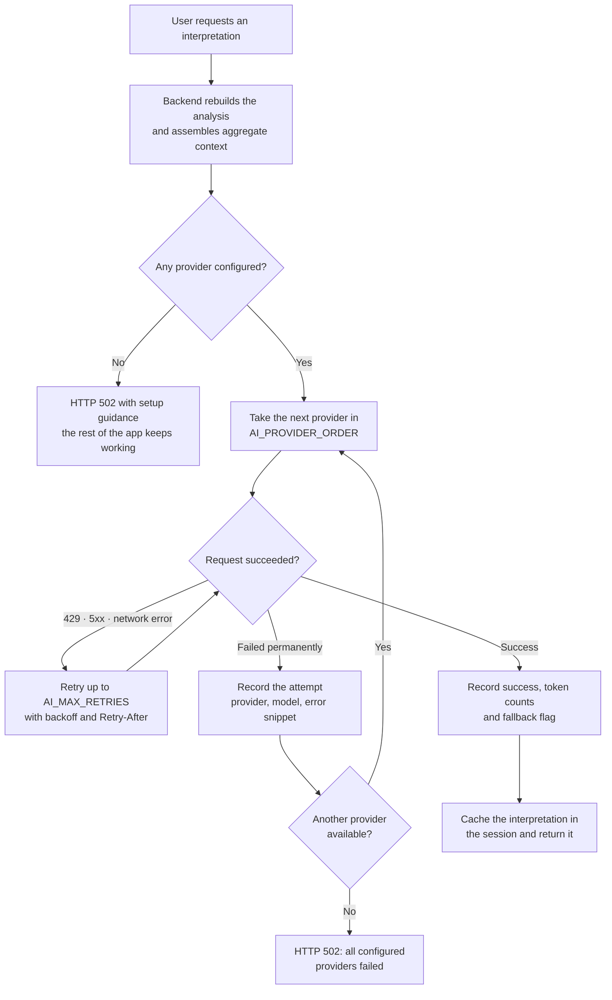

| Property | Behaviour |
| --- | --- |
| Default order | `groq,gemini,openrouter`, overridable with `AI_PROVIDER_ORDER` |
| Eligibility | A provider is attempted only when both its API key and model name are set |
| Retries | Only transient failures (HTTP 429, 5xx, network errors), up to `AI_MAX_RETRIES` with linear backoff |
| Usage ledger | Every attempt appended to `backend/data/ai_usage.json`, exposed read-only through `/api/ai/usage` and `/api/ai/history` |
| Error hygiene | Provider errors are trimmed to a short message; keys are never echoed to the browser or written to logs |
| Privacy | The prompt contains statistics, column names and model metrics — never individual rows |
| Optionality | With no keys configured, fusion, EDA, charts, training, prediction and reports all continue to work |

> AI Insights depends on third-party availability and quotas. Keys are read only by the backend, and a provider failure degrades to an explicit error message rather than a silent fallback to invented content.

---

## Project Structure

```text
DataFusion-AI/
├── backend/
│   ├── app/
│   │   ├── main.py                    FastAPI app: routes, ownership middleware, SPA serving
│   │   ├── pipeline.py                Seven-stage orchestration with real timings
│   │   ├── ingest.py                  Upload validation and multi-format parsing
│   │   ├── cleaning.py                Per-source wrangling with a traceable report
│   │   ├── fusion.py                  Key detection, fuzzy matching, conflict resolution
│   │   ├── analysis.py                EDA, target suggestion, insights, chart payloads
│   │   ├── modeling.py                Four estimators, CV, metrics, importance, prediction
│   │   ├── reporting.py               PDF, XLSX and CSV artefacts
│   │   ├── ai_service.py              Provider fallback chain and token ledger
│   │   ├── jobs.py                    Job state, stage timings, confirmation pause
│   │   ├── store.py                   Disk-backed sessions and jobs
│   │   └── utils.py                   JSON safety and naming helpers
│   ├── scripts/
│   │   └── claim_legacy_sessions.py   Manual adoption of pre-ownership sessions
│   ├── tests/                         68 pytest tests across API, pipeline and persistence
│   ├── requirements.txt               Runtime dependencies
│   ├── requirements-dev.txt           Adds pytest and httpx
│   ├── pytest.ini
│   └── .env.example                   Backend configuration template
├── frontend/
│   ├── src/
│   │   ├── pages/
│   │   │   ├── Dashboard.tsx          Landing page, capabilities, workflow
│   │   │   ├── Upload.tsx             Multi-file upload and session restore
│   │   │   ├── FusionProcess.tsx      Live stage progress and key confirmation
│   │   │   ├── History.tsx            Session history
│   │   │   ├── FusionReports.tsx      Generated reports
│   │   │   ├── Workspace.tsx          Sidebar shell and section routing
│   │   │   └── workspace/             Overview, CleanData, CombineData, Analyse,
│   │   │                              Charts, Train, Insights, Predict, Reports
│   │   ├── components/                Navbar, Logo, FusionScene3D, ChartCard, UI kit
│   │   ├── lib/                       API client, types, session, theme, toast, format
│   │   ├── index.css                  Design tokens for both themes
│   │   └── App.tsx                    Client-side routes
│   ├── vercel.json                    SPA rewrite for Vercel deep links
│   ├── vite.config.ts                 Dev proxy to the FastAPI port
│   ├── tailwind.config.js
│   ├── package.json
│   └── .env.example                   Frontend configuration template
├── docs/screenshots/                  Numbered screenshot assets referenced by this README
├── hero-*.png                         Landing-page captures used in this README
├── run.py                             One-command local runner
├── .gitignore
└── README.md
```

Generated artefacts (`backend/data/`), the virtual environment, `node_modules/`, build output and logs are ignored by Git.

---

## Local Setup

### Prerequisites

| Requirement | Version |
| --- | --- |
| Python | 3.10 or newer |
| Node.js | 18 or newer (npm included) |

No database, container or cloud account is required. AI keys are optional.

### Quick start (one command)

```bash
git clone https://github.com/Adithyaravi10/DataFusion-AI.git
cd DataFusion-AI
python run.py
```

On first run the script creates `.venv`, installs `backend/requirements.txt`, runs `npm install`, then starts FastAPI on `127.0.0.1:8000` and Vite on `127.0.0.1:5173`, waits for both to answer, and opens the app. Logs stream to `backend-server.log` and `frontend-dev.log`.

```bash
python run.py --no-browser
python run.py --backend-port 8001 --frontend-port 5174
python run.py --production            # build the SPA and serve it from FastAPI on one port
```

Press `Ctrl+C` to stop both processes.

### Manual setup — Windows (PowerShell)

```powershell
python -m venv .venv
.\.venv\Scripts\Activate.ps1
pip install -r backend\requirements.txt

cd backend
python -m uvicorn app.main:app --reload --host 127.0.0.1 --port 8000
```

Second terminal:

```powershell
cd frontend
npm install
npm run dev
```

### Manual setup — macOS and Linux

```bash
python3 -m venv .venv
source .venv/bin/activate
pip install -r backend/requirements.txt

cd backend
python -m uvicorn app.main:app --reload --host 127.0.0.1 --port 8000
```

Second terminal:

```bash
cd frontend
npm install
npm run dev
```

Open <http://127.0.0.1:5173>. The Vite dev server proxies `/api` to `http://127.0.0.1:8000`.

### Ports and proxies

| Service | Default | Note |
| --- | --- | --- |
| FastAPI | `127.0.0.1:8000` | API docs at `/docs`, health at `/api/health` |
| Vite dev server | `127.0.0.1:5173` | Proxies `/api` to the backend |

If port 8000 is already in use, start the backend on another port and point the frontend at it:

```bash
# macOS / Linux
DATAFUSION_API=http://127.0.0.1:8001 npm run dev
```

```powershell
# Windows PowerShell
$env:DATAFUSION_API = "http://127.0.0.1:8001"; npm run dev
```

Alternatively set `VITE_API_URL=http://127.0.0.1:8001` in `frontend/.env`, which makes the app call that origin directly instead of using the proxy. The two servers bind differently: `python run.py` and the manual `uvicorn --host 127.0.0.1` command bind the backend to IPv4 explicitly, while `vite.config.ts` sets `host: "localhost"`, so a plain `npm run dev` follows your system's resolution of `localhost`. If `localhost` resolves to IPv6 on your machine, use `127.0.0.1` in the browser and in `DATAFUSION_API` or `VITE_API_URL`.

### Verification commands

```bash
cd backend && python -m pytest        # 68 tests
cd frontend && npm run build          # type-checks, then builds to dist/
```

---

## Environment Variables

Copy the templates before configuring a deployment: `backend/.env.example` → `backend/.env` and `frontend/.env.example` → `frontend/.env`. Both `.env` files are git-ignored; never commit real values.

### Backend

| Variable | Required | Default | Purpose |
| --- | --- | --- | --- |
| `CORS_ORIGINS` | Production | empty | Comma-separated allowlist of browser origins. Empty allows `localhost`/`127.0.0.1` on any port for development |
| `DATA_DIR` | Production | `backend/data` | Storage root for sessions, uploads, models, predictions and reports. Point at a mounted volume (for example `/data`) |
| `FRONTEND_DIST` | No | `../frontend/dist` | Location of the built SPA when FastAPI serves the frontend |
| `APP_TIMEZONE` | No | `Asia/Kolkata` | Display timezone for dashboard and log timestamps; storage stays UTC |
| `AI_PROVIDER_ORDER` | No | `groq,gemini,openrouter` | Attempt order for AI providers |
| `GROQ_API_KEY`, `GROQ_MODEL` | No | empty | Groq credentials; both must be set to enable the provider |
| `GEMINI_API_KEY`, `GEMINI_MODEL` | No | empty | Google Gemini credentials and model name |
| `OPENROUTER_API_KEY`, `OPENROUTER_MODEL` | No | empty | OpenRouter credentials and model name |
| `AI_REQUEST_TIMEOUT` | No | `30` | Per-request timeout in seconds (minimum 5) |
| `AI_MAX_RETRIES` | No | `2` | Retries for transient provider failures only |

### Frontend

| Variable | Required | Default | Purpose |
| --- | --- | --- | --- |
| `VITE_API_URL` | Split deployment only | empty | Full API origin without a trailing slash, for example `https://datafusion-ai-production.up.railway.app`. Empty means same-origin / Vite proxy |

> Keys and connection values belong in `.env` files or the hosting provider's secret settings. They are read by the backend only and are never sent to the browser.

---

## API Overview

All application endpoints live under `/api`. Session-scoped routes require the caller's ownership token and return `404` for a session owned by another browser.

### System and sessions

| Method | Endpoint | Purpose |
| --- | --- | --- |
| `GET` | `/api/health` | Service status, storage path, writability |
| `GET` | `/api/history` | Sessions owned by the caller |
| `GET` | `/api/session/{session_id}` | Session detail: files, fusion statistics, model, reports |
| `DELETE` | `/api/history/{session_id}` | Delete a session and its artefacts |

### Upload and sources

| Method | Endpoint | Purpose |
| --- | --- | --- |
| `POST` | `/api/upload` | Upload one or more files into a new session |
| `POST` | `/api/session/{session_id}/files` | Add sources to an existing session |
| `GET` | `/api/files/{session_id}/preview?file_id=…` | Stored preview and columns for one file |
| `DELETE` | `/api/session/{session_id}/files/{file_id}` | Remove a source and reset derived state |

### Fusion

| Method | Endpoint | Purpose |
| --- | --- | --- |
| `POST` | `/api/fuse` | Start the fusion job (optionally with join-key overrides) |
| `GET` | `/api/fuse/{job_id}/status` | Job state, stages, durations, logs, progress |
| `GET` | `/api/fuse/{job_id}/stream` | Server-sent events with the same state |
| `POST` | `/api/fuse/{job_id}/confirm` | Supply keys and resume a paused job |

### Workspace

| Method | Endpoint | Purpose |
| --- | --- | --- |
| `GET` | `/api/session/{id}/clean` | Wrangling reports, totals and download links |
| `GET` | `/api/session/{id}/clean/{file_id}/download` | Cleaned source as CSV |
| `GET` | `/api/session/{id}/combine` | Join plan, conflicts and paginated fused preview |
| `GET` | `/api/session/{id}/fused/download` | Fused dataset as CSV |
| `GET` | `/api/session/{id}/analyse` | Overview, statistical summary, insights, correlation |
| `GET` | `/api/session/{id}/charts` | Chart series for the charts tab |

### Machine learning

| Method | Endpoint | Purpose |
| --- | --- | --- |
| `POST` | `/api/train` | Train and cross-validate four models for a target |
| `GET` | `/api/session/{id}/model` | Persisted model metadata and evaluation |
| `POST` | `/api/predict` | Score a single JSON record |
| `POST` | `/api/predict/batch?session_id=…` | Score an uploaded CSV/TSV |
| `GET` | `/api/session/{id}/predictions/{filename}/download` | Download batch predictions |

### AI insights

| Method | Endpoint | Purpose |
| --- | --- | --- |
| `GET` | `/api/session/{id}/ai-insights` | Cached interpretation for the session |
| `POST` | `/api/session/{id}/ai-insights` | Generate an interpretation (optional question, max 1000 characters) |
| `GET` | `/api/ai/providers` | Provider order, models, configured state |
| `GET` | `/api/ai/usage` | Token and success totals per provider |
| `GET` | `/api/ai/history?limit=…` | Recent attempts, failures and fallback reasons |

### Reports

| Method | Endpoint | Purpose |
| --- | --- | --- |
| `POST` | `/api/report` | Generate PDF, CSV and XLSX for a session |
| `GET` | `/api/reports` | All reports owned by the caller |
| `GET` | `/api/reports/{session_id}/{report_id}/download?kind=pdf\|csv\|xlsx` | Download one artefact |

Interactive documentation for the deployed API is available at `/docs`; the development equivalent is <http://127.0.0.1:8000/docs>.

---

## Production Deployment

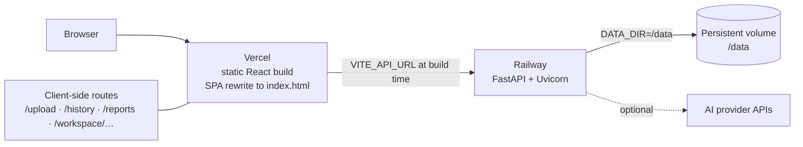

### Frontend — Vercel

| Setting | Value |
| --- | --- |
| Root Directory | `frontend` |
| Framework preset | Vite |
| Build command | `npm run build` |
| Output directory | `dist` |
| Environment variable | `VITE_API_URL=https://datafusion-ai-production.up.railway.app` (build time) |

`frontend/vercel.json` rewrites every unmatched path to `/index.html`:

```json
{
  "$schema": "https://openapi.vercel.sh/vercel.json",
  "rewrites": [{ "source": "/(.*)", "destination": "/index.html" }]
}
```

This is what makes deep links work: a direct request or refresh on `/upload`, `/history`, `/reports` or `/workspace/{id}/train loads the SPA shell instead of returning a 404. Real files such as `/assets/index-*.js` are served before the rewrite applies, so hashed assets are unaffected.

Because the API origin is baked in at build time, changing `VITE_API_URL` requires a redeploy.

### Backend — Railway

| Setting | Value |
| --- | --- |
| Root Directory | `backend` |
| Install command | `pip install -r requirements.txt` |
| Start command | `uvicorn app.main:app --host 0.0.0.0 --port $PORT` |
| Health check path | `/api/health` |
| Volume mount path | `/data` |
| Environment variables | `DATA_DIR=/data`, `CORS_ORIGINS=https://datafusion-ai-frontend.vercel.app`, plus optional AI keys |
| Instances | One (the job registry is in memory) |

`DATA_DIR=/data` is not optional for persistence. Railway's container filesystem is replaced on every deploy and restart; without a mounted volume, sessions, models and reports disappear. The backend logs a warning at startup when it detects Railway without `DATA_DIR`, and `/api/health` reports the resolved path and whether it is writable.

`GET /api/health` on the live deployment currently reports:

```json
{
  "status": "ok",
  "service": "DataFusion AI",
  "storage": {
    "data_dir": "/data",
    "sessions_dir": "/data/sessions",
    "configured": true,
    "writable": true
  }
}
```

Two deployment modes are supported:

- **Split (used by the live application):** Vercel serves the SPA, Railway serves the API. `VITE_API_URL` and `CORS_ORIGINS` must reference each other's origins.
- **Single process:** run `python run.py --production --host 0.0.0.0 --backend-port 8000`. FastAPI serves `frontend/dist` at `/` with an SPA fallback while keeping `/api/*` separate, so a single container can host the whole product.

### Session ownership and persistence

Sessions are scoped to a browser, not to a user account:

1. On first contact the browser generates an unpredictable token (32 URL-safe bytes) and persists it in `localStorage`; it is sent on every request as the `X-DF-Owner` header.
2. If a request arrives without a valid token, the backend mints one and mirrors it into an `HttpOnly` `df_owner` cookie (`SameSite=None; Secure` over HTTPS, `SameSite=Lax` locally) with a 180-day lifetime.
3. Only the **SHA-256 hash** of the token is stored in `meta.json`. The raw token never reaches disk.
4. Every session lookup compares the hash. Another browser asking for that session receives `404` and cannot list, download, delete or extend it.

**This is ownership, not authentication.** There is no account, password, email verification, role or server-issued identity — anyone holding the token, or the browser profile that stores it, has access. Clearing site data, using private browsing or switching browsers means the sessions created earlier become unreachable, because nothing maps a person to their data. Treat the deployment as private-by-obscurity rather than private-by-account, and never upload sensitive data to a public instance.

### Persisted data layout

```text
/data/
├── sessions/
│   └── {session_id}/
│       ├── meta.json            owner hash, status, files, fusion stats, model, reports
│       ├── raw/                 original uploads
│       ├── processed/           cleaned sources, fused pickle, fused CSV
│       ├── model/               model.joblib and evaluation.joblib
│       ├── predictions/         batch prediction outputs
│       └── reports/{report_id}/ PDF, XLSX, CSV and chart PNGs
├── jobs/                        one JSON document per fusion job
└── ai_usage.json                provider token ledger (backend-local, see limitations)
```

---

## Known Limitations

**Functional scope**

- No authentication or multi-user accounts. Ownership is per browser token (see above); there is no way to recover access to sessions from another device, and no sharing between users.
- No database or object store. Storage is the filesystem, which means a single instance and no horizontal scaling.
- Fusion is key-based: sources without a detectable or user-confirmed shared key cannot be merged. Numeric-only, date-range or positional joins are not supported.
- Fuzzy linking is limited to token-sort similarity at a threshold of 88; it is not entity resolution and does not learn.
- Reports are generated on demand from the stored run. They are not versioned or refreshed automatically when the session changes afterwards.
- Charts and reports are derived artefacts: deleting a session deletes its models, predictions and reports with it.

**Data and compute limits**

- 25 MB and 200,000 rows per uploaded file; 10 sources per session.
- Batch prediction accepts CSV/TSV only, up to 5,000 rows, and requires the trained feature columns.
- Training samples at most 8,000 rows (seed 42) for runtime; the UI and report state that metrics reflect the sample.
- Legacy `.xls` files are read through the generic `xlrd` path and are not covered by an automated fixture test.

**AI**

- AI Insights is optional and depends on provider availability and quotas. It requires at least one complete key/model pair, and any provider can rate-limit or fail.
- The provider usage ledger is written to `backend/data/ai_usage.json`, which is independent of `DATA_DIR`; on Railway it is not on the mounted volume and therefore resets on redeploy. Cached interpretations themselves live in each session's `meta.json` and do persist.
- The interpretation is explanatory only. It never computes, changes or replaces a metric.

**Hosting on free tiers**

- Railway free/trial plans are usage-limited and services can sleep; the first request after idling is slow, and a restart marks any in-flight fusion job as failed with a clear message.
- Railway volumes consume plan storage and are bound to a single service; backups are the operator's responsibility.
- Vercel's free tier has bandwidth and build limits, and each preview/production build consumes build minutes.
- Neither platform provides an SLA for a hobby deployment. Both URLs are public, so the deployment should not hold confidential data.
- Because the frontend API URL is compiled into the bundle, rotating the backend origin requires a frontend rebuild.

---

## Future Enhancements

- Account-based authentication with per-user isolation, so sessions are recoverable across devices.
- A task queue and worker process, replacing the in-process job registry and enabling more than one API replica.
- Migrating session metadata and artefacts to a database and object storage, keeping the filesystem for development.
- Additional estimators (gradient boosting) and hyper-parameter search behind the same honest evaluation protocol.
- Saved fusion recipes that can be re-applied to refreshed exports.
- Scheduled re-runs that regenerate predictions and reports as new source files arrive.
- Data-lineage visualisation for the conflict log, showing which source won each reconciled cell.
- Streaming uploads with resumable transfer for datasets near the current size limit.

---

## Contributing

Issues and pull requests are welcome.

1. Fork the repository and create a branch: `git checkout -b feature/short-description`.
2. Keep changes scoped; preserve the existing API contracts unless the change requires otherwise.
3. Install the development extras and run the checks before opening a pull request:

   ```bash
   cd backend
   pip install -r requirements-dev.txt
   python -m pytest

   cd ../frontend
   npm install
   npx tsc --noEmit
   npm run build
   ```

4. Describe the motivation, the behaviour change and how it was verified.

Please do not commit `.env` files, API keys, generated session data under `backend/data/`, or build output.

---

## License

This repository does not currently include a `LICENSE` file, so no open-source license has been granted: the default is that all rights are reserved by the author. If you intend to reuse, modify or distribute this project, add a license first — for example MIT — and mention it here.

For questions about the project, open an issue on [GitHub](https://github.com/Adithyaravi10/DataFusion-AI).

---

<p align="center"><sub>DataFusion AI — FastAPI · React · scikit-learn. Every metric, chart and report in the application is computed from the datasets the user uploads.</sub></p>
